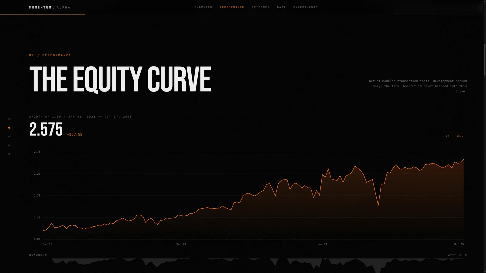
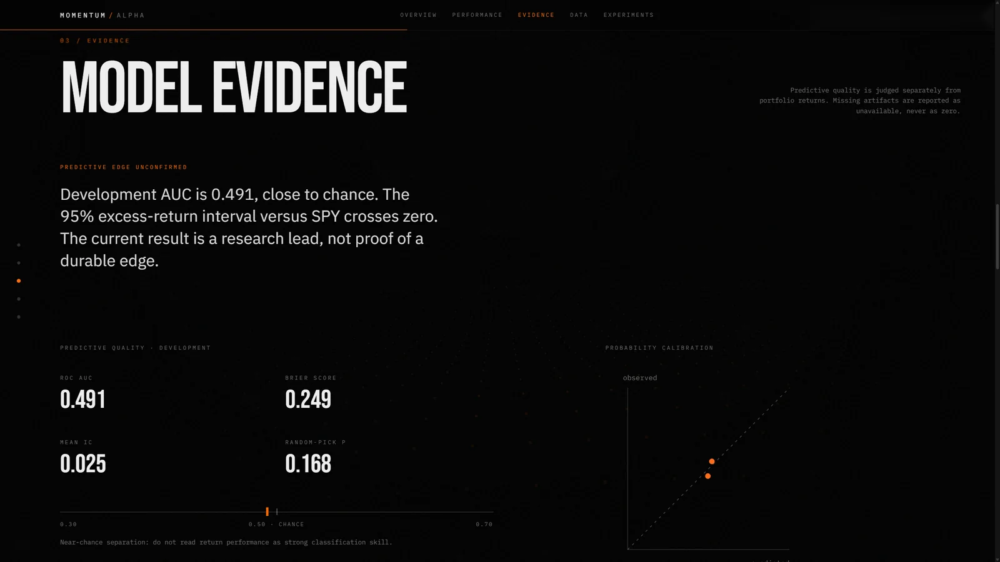
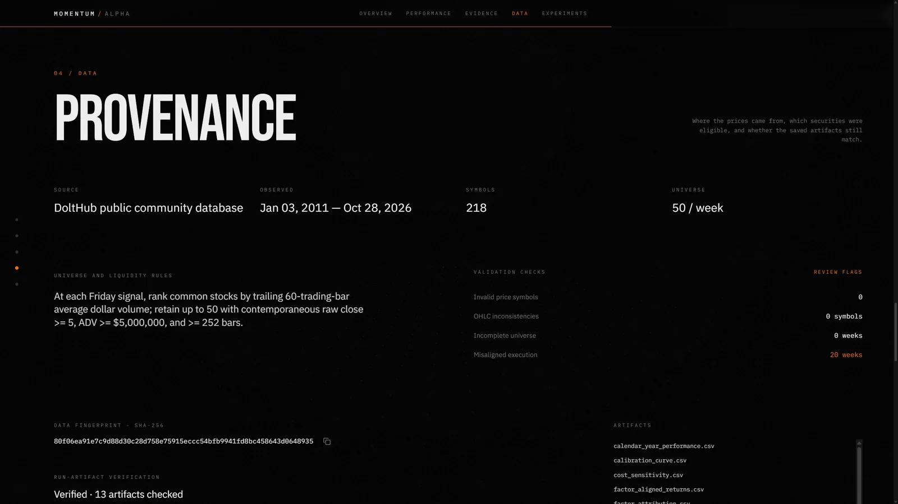

# MomentumAlpha

<strong>A research terminal for systematic weekly equity momentum.</strong>

Python research pipeline | FastAPI | Next.js | walk-forward evaluation

MomentumAlpha turns historical market data into a weekly stock universe, model scores, portfolio simulations, and research diagnostics. A local web terminal lets you inspect saved runs, verify their artifacts, and launch a new experiment when you choose.

## What it does

- Builds either a fixed Yahoo Finance ticker universe or a weekly liquidity-ranked universe from the public [DoltHub stocks database](https://www.dolthub.com/repositories/post-no-preference/stocks).
- Computes technical, market-state, and cross-sectional features for weekly ranking.
- Runs walk-forward model fitting and portfolio simulation with configurable transaction costs and rebalance schedules.
- Reports predictive quality separately from portfolio performance, including calibration, rank information coefficients, feature stability, factor attribution, cost sensitivity, and bootstrap or random-selection comparisons.
- Stores run metadata and experiment history in SQLite, writes artifacts with manifests, and exposes verification through a FastAPI service.
- Connects the API to a Next.js research terminal for performance, evidence, data-provenance, and experiment views.

## Dashboard

### Performance

### Model evidence

### Data provenance

## Research status and limitations

These screenshots show a locally saved development run, **00cdb5e8f9d74338**, created on October 29, 2026. Its 144-week development window (January 6, 2023 to October 17, 2025) reports a 2.575 growth multiple (+157.5%), 40.7% annualized net return, 0.96 Sharpe ratio, and -35.0% maximum drawdown after modeled transaction costs.

Those are development-period backtest results, not independent out-of-sample results. The run's 52-week final holdout was reserved and not evaluated. The data report also flags 20 weeks with misaligned execution dates; inspect the saved quality report before interpreting the portfolio curve. Development AUC is 0.491, close to chance, and the 95% excess-return interval crosses zero. The current evidence does **not** establish a durable predictive or trading edge. MomentumAlpha is a research project, not a live trading system or investment advice.

Run outputs and market-data caches are local and gitignored. The screenshots are interface snapshots; a fresh clone starts without the saved run shown above. Create a run explicitly from the Experiments page or the CLI to populate the terminal.

## Architecture

    Market data -> validation and feature engineering -> walk-forward research
                -> experiment ledger and artifacts -> FastAPI -> Next.js terminal

| Area | Main files | Responsibility |
| --- | --- | --- |
| Research pipeline | main.py, research.py, modeling.py, backtest.py | Walk-forward fitting, portfolio simulation, and research outputs |
| Data and features | data_loader.py, dolt_data_loader.py, features.py, factor_data.py | Price data, universe construction, features, and benchmark factors |
| Evidence and tracking | evidence.py, experiment_ledger.py, factor_attribution.py, market_data_quality.py | Diagnostics, run records, quality checks, and artifact verification |
| API | api.py | Health, readiness, run submission, results, and artifact endpoints |
| Dashboard | frontend-terminal/ | Next.js terminal for browsing and launching research |
| Tests | tests/ | Focused checks for the backend and research pipeline |

Generated market data and run records live in .cache/ and .runs/; neither directory is committed.

## Run locally on Windows

Clone and enter the repository:

    git clone https://github.com/jetashjethi-ui/MomentumAlpha-.git
    cd MomentumAlpha-

### Requirements

- Python 3.12
- Node.js 20.9 or newer

### Install the backend

From the repository root, create the environment and install the backend dependencies:

    py -3.12 -m venv .venv
    .\.venv\Scripts\python.exe -m pip install --upgrade pip
    .\.venv\Scripts\python.exe -m pip install -r requirements.txt

### Start the API

In the first PowerShell window, from the repository root:

    .\.venv\Scripts\python.exe -m uvicorn api:app --host 127.0.0.1 --port 8000 --workers 1

### Start the dashboard

In a second PowerShell window, from the repository root:

    .\frontend-terminal\run-dev.ps1

The script installs the locked frontend dependencies if needed and starts the dashboard at <http://127.0.0.1:3000/>. The API is available at <http://127.0.0.1:8000/> and its interactive documentation is at <http://127.0.0.1:8000/docs>.

Starting these services does not train a model. On a clean clone, the terminal has no saved runs until you explicitly launch one from Experiments or run:

    .\.venv\Scripts\python.exe main.py --data-source yahoo --evaluation-mode development

That command downloads market data and starts a research run. It can take a while. The default Yahoo source uses a fixed ticker list. The optional Dolt source uses the Dolt CLI and a local clone of the public stock database. For factor attribution, the pipeline can retrieve data from the [Kenneth R. French Data Library](https://mba.tuck.dartmouth.edu/pages/faculty/Ken.French/data_library.html). Data availability and historical coverage depend on the selected source.

## API

| Method | Path | Purpose |
| --- | --- | --- |
| GET | /health | Process health |
| GET | /ready | Backend and local-storage readiness |
| POST | /runs | Submit an explicitly configured research run |
| GET | /runs | List recorded runs |
| GET | /runs/{run_id}/result | Read the selected run summary |
| GET | /runs/{run_id}/verification | Verify saved artifacts |
| GET | /runs/{run_id}/artifacts | List available artifacts |

The API binds to localhost in the examples. Submitting a run can start a CPU-intensive research job; public hosting needs access controls and resource limits.

## Development checks

Install the focused development dependencies and run the backend checks:

    .\.venv\Scripts\python.exe -m pip install -r requirements-dev.txt
    .\.venv\Scripts\python.exe -m pytest

Build the dashboard:

    cd frontend-terminal
    npx --yes pnpm@10 build

## Data sources

- [DoltHub public US stocks database](https://www.dolthub.com/repositories/post-no-preference/stocks)
- [Yahoo Finance historical-data help](https://help.yahoo.com/kb/sln2311.html)
- [Kenneth R. French Data Library](https://mba.tuck.dartmouth.edu/pages/faculty/Ken.French/data_library.html)

Market-data providers can revise or omit observations. The pipeline performs validation and records data fingerprints, but source quality and coverage remain research limitations. See [LICENSE](LICENSE) for reuse terms.
